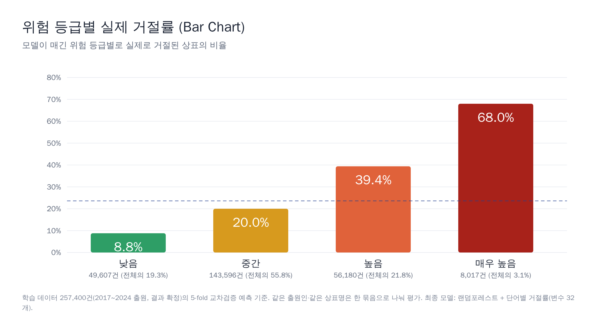
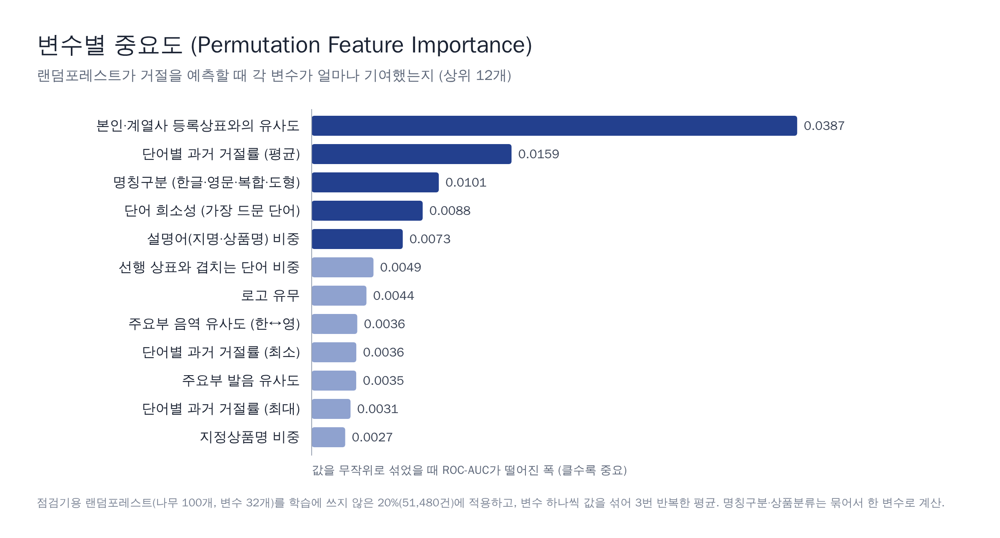

# 공공데이터 기반 식음료 상표 거절 위험 예측

출원 전 거절 위험 신호와 근거를 보여주는 1차 점검 도구입니다. 상표명·지정상품·로고 유무를 넣으면 KIPRIS 과거 심사 데이터로 학습한 랜덤포레스트가 **거절 확률·위험 등급·예상 거절 유형·비슷한 선행 상표**를 알려줍니다.

2026 데이터+AI 혁신 챌린지 · 데이터레시피 출품작 · [점검기 바로가기](https://claude.ai/artifact/WWQhvbtfBTHPfRATmEwbzb)

> 법률 판단을 대신하지 않는 출원 전 보조 도구입니다.

## 1. 데이터
- 범위: 식음료 4개 류(29·30·32·43류), 2017~2024 출원 **257,400건**(거절률 23.56%, 거절 60,642건)
- 라벨: 등록·공고·소멸 = 1, 거절 = 0. 출원 중·포기·취하·무효·공존동의·최근 3개월 거절결정(386건) 제외
  - 평가 지표(ROC-AUC·PR-AUC·Brier)는 거절을 양성(1)으로 뒤집어 계산합니다(reject = 1 − registered). evaluation/의 "거절 = 1"은 이 기준입니다.
- 비교 기준 C: 유사군코드가 1개 이상 겹치는 먼저 출원된 타인 상표. 다른 류(5·31·33·1류)도 비교하고, 35류 판매업은 시험 후 제외 → **비교 풀 750,680건**
  - 근거: 「유사상품 심사기준」 제5조(류 구분과 관계없이 원칙적으로 유사군코드 기준으로 판단), 제7조②
- 거절 사유: KIPRIS Plus 거절결정서 조항 17,310건 (선행 유사 73.0%, 식별력 60.0%, 중복 포함)
- 원자료는 KIPRIS 이용약관 제16조에 따라 공개하지 않습니다. [data/](data/)에 예시 30줄(출원인 익명 ID)과 수집 조건만 있습니다.

## 2. 방법
- 변수 28 + 4개: 선행 상표 충돌(주요부 발음·음역·포함 유사도), 식별력(설명어·상품명·지명 비중, 로고), 본인·계열사 상표 유사도, 단어별 과거 거절률(먼저 출원된 상표만)
- 본인·계열사 제외: 출원인 판별 규칙 5개, 그룹 최대 20곳
- 검증: StratifiedGroupKFold(5), 같은 출원인 + 같은 상표명을 한 그룹으로
- 누수 방지: 출원일 이후 정보와 거절 사유는 입력 변수로 쓰지 않음

## 3. 결과
세 모델을 같은 257,400행·같은 fold로 다시 계산했습니다([evaluation/](evaluation/)).

| 모델 | 변수 | 5-fold ROC-AUC | PR-AUC | Brier | 2023~24 ROC-AUC |
|---|---|---|---|---|---|
| 해인 RF | 28 | 0.694 | 0.430 | 0.163 | 0.713 |
| 예환 XGB | 54 | 0.725 | 0.466 | 0.157 | 0.721 |
| 가은 XGB | 219 | 0.654 | 0.374 | 0.170 | 0.664 |
| **최종: 해인 RF + 단어별 거절률** | 32 | 0.704 | 0.443 | 0.161 | **0.723** |

최종 모델은 2023~24 새 데이터에서 예환 XGB와 통계적 차이가 없고(−0.002 [−0.006, +0.002]), 출원인 정보 없이 점검기 입력만으로 계산할 수 있어 선택했습니다.

**위험 등급 4단계** (isotonic 보정 확률 기준)

| 등급 | 기준 | 실제 거절률 |
|---|---|---|
| 낮음 | 12% 미만 | 8.8% |
| 중간 | 12~30% | 20.0% |
| 높음 | 30~60% | 39.4% |
| 매우 높음 | 60% 이상 | 68.0% |

낮음 등급의 실제 등록률은 94.6%(2023~24 새 데이터 기준)입니다. 예: "보성녹차라떼"(30류) 글자만 83.1%(매우 높음) → 로고 추가 28.0%(중간).

## 4. 한계
관념 유사(해↔SUN)·도형 유사 미반영, 수집하지 않은 류, 상표권 갱신 미반영, 흔한 주요부 과경고, 거절 유형 적중률 46.3%로 아직 낮음.

## 5. 폴더
| 폴더 | 내용 |
|---|---|
| [data/](data/) | 예시 30줄, 수집 조건 |
| [dictionaries/](dictionaries/) | 지명·상품 단어·영문 설명어 사전, 지정상품 → 유사군코드 대응표 생성 코드 |
| [src/](src/) | 01 수집 파일 합치기 → 02 비교 풀·출원인 그룹 → 03 변수 → 04 라벨·fold |
| [models/](models/) | rf_haein(해인), xgb_yehwan(예환), xgb_gaeun(가은), rf_final(최종 모델), rej_type(거절 유형 보조 모델) |
| [evaluation/](evaluation/) | 세 모델 비교, 요인 분석, 2023~24 시간 분할 시험 |
| [checker/](checker/) | 점검기용 경량 모델 내보내기 |
| [docs/](docs/) | 결과 이미지, [팀 진행 이력](docs/process.md) |

## 6. 팀원과 역할
| 단계 | 담당 |
|---|---|
| 데이터 수집·전처리 | 공통 |
| 모델 개발 | 해인: 랜덤포레스트 28변수 / 예환: XGBoost 54변수 / 가은: XGBoost 219변수 |
| 모델 비교·최종 모델 선정, 위험 등급 | 공통 |
| 거절 유형 보조 모델, 점검기 | 공통 (구현: 해인) |

## 출처
KIPRIS, KIPRIS Plus, 「유사상품 심사기준」, 헬프미, 셀로, e-나라지표, 데이터레시피 공모
