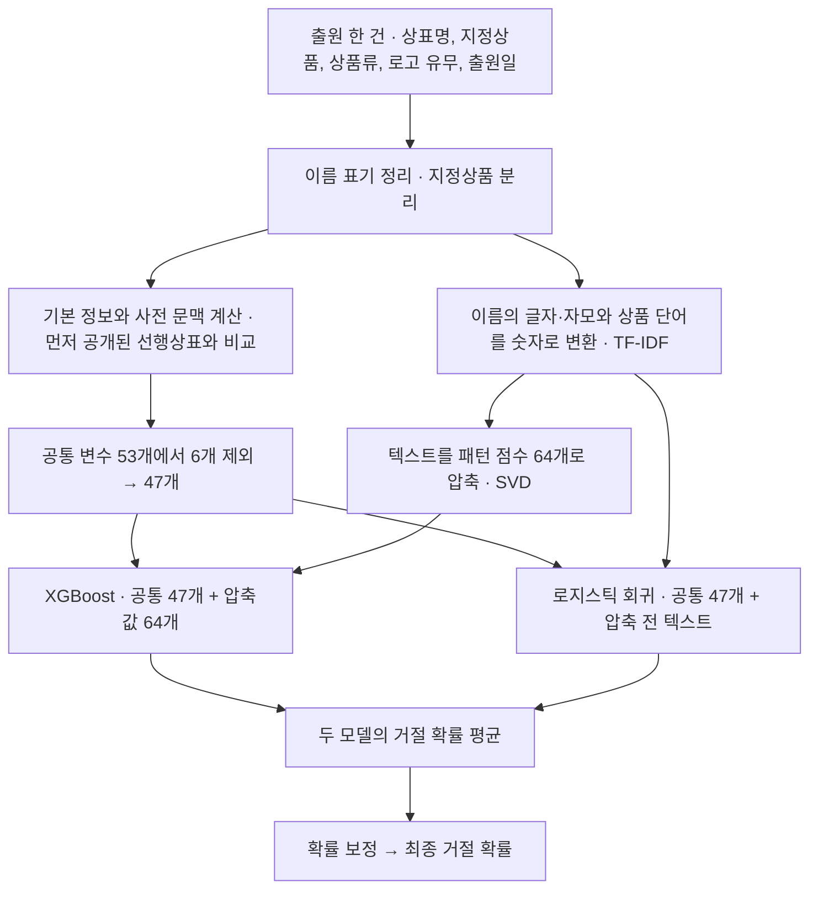

# V9 모델 구조와 실행 방법

[두 모델의 팀 평가 결과](../README.md) · [V1~V9 개발 이력](docs/VERSION_HISTORY.md)

## 원본 V9의 개발 조건과 성능

원본 V9는 등록결정 또는 거절결정을 확인한 출원으로 자체 평가 표본을 구성했습니다.

| 항목 | 내용 |
|---|---|
| 문제 | 출원 시점에 알 수 있는 정보만으로 등록/거절 결정 예측 (이진 분류, 거절 약 21%) |
| 입력 | 상표명, 지정상품, 상품류, 로고 유무, 출원일 |
| 핵심 특징 | 출원일 이전에 공개된 선행상표와의 이름·발음·요부 유사도 × 지정상품 겹침 |
| 모델 | XGBoost + 문자 TF-IDF 로지스틱 회귀 (0.5 : 0.5), 시그모이드 확률 보정 |
| 검증 | 시간 순서 분할 (2017–21 학습 / 2022 보정 / 2023 선택 / 2024–26 사후 비교) |
| 성능 | 2024년 28,588건 ROC-AUC **0.709**, PR-AUC 0.400 (첫 버전은 0.657, 0.316 — 표본 구성이 달라 참고용) |

## 47변수 V9의 입력 구성과 예측 과정

팀 데이터로 재학습한 V9는 두 모델의 공통 변수를 53개에서 47개로 줄였습니다. 텍스트 압축값은 64개로 유지해 XGBoost의 입력은 출원 한 건당 117개에서 111개로 줄었습니다.



### 공통 변수 47개의 구성

공통 변수는 XGBoost와 로지스틱 회귀에 동일하게 입력하는 값입니다. 상표명이 ‘제주보리한잔’이고 지정상품이 ‘보리차’인 가상 출원을 예로 들면, 다음 세 종류의 정보를 계산합니다.

| 변수 묶음 | 이 출원에서 계산하는 값의 예 | 원본 → 축소 |
|---|---|---:|
| 기본 정보 | 이름 길이, 한글 비율, 로고 유무, 지정상품 수 | 11 → 11개 |
| 사전 문맥 | ‘보리’처럼 원재료를 뜻하는 표현이 상표명과 지정상품 양쪽에 나타나는 정도 | 10 → 6개 |
| 선행상표 검색 | 출원일과 공고일이 모두 이번 출원보다 이른 상표를 찾아, 같은 후보에서 이름·발음이 비슷하고 상품도 겹치는 정도 | 32 → 30개 |
| **합계** | | **53 → 47개** |

변수를 줄일 때는 학습 표본 전체에서 값이 0인 문맥 변수 4개와 다른 변수와 값이 일치하는 검색 변수 1개를 먼저 제외했습니다. 여기에 다른 문자 유사도 변수와 순위가 거의 같은 검색 변수 1개를 추가로 제외해 47개를 선정했습니다. [변수 선정 근거](docs/v9_shared_correlation/README.md)

### 텍스트 변환과 모델별 입력

상표명과 지정상품에 실제로 쓰인 표현도 예측에 활용합니다. ‘제주보리한잔’에서는 ‘제주’, ‘보리’, ‘한잔’ 같은 글자 조각과 한글 자모를 추출하고, 지정상품에서는 ‘보리차’ 같은 단어를 추출합니다. TF-IDF는 각 표현이 해당 출원에 나타나는 빈도와 전체 학습 자료에서 얼마나 흔한지를 반영해 수치로 변환하는 방법입니다.

| 모델 | 출원 한 건의 입력 |
|---|---|
| XGBoost | **공통 변수 47개 + 텍스트 압축값 64개 = 총 111개**. SVD(특잇값 분해)는 여러 표현이 함께 나타나는 패턴을 학습해 각 출원의 텍스트를 64개 값으로 요약합니다. |
| 로지스틱 회귀 | **공통 변수 47개 + 압축 전 TF-IDF 값**. 글자 조각과 상품 단어 각각이 거절 예측에 미치는 영향을 계수로 학습합니다. |

두 모델이 각각 30%와 20%의 거절 확률을 예측했다면 평균은 25%입니다. 최종 확률은 이 평균에 보정 함수를 적용한 값입니다. 보정 함수는 모델 학습과 분리한 자료에서 예측값과 실제 거절률의 관계를 학습합니다.

## 원본 모델의 버전별 성능

아래 지표는 같은 2024년 출원을 대상으로 계산했습니다. 여러 버전을 개발하면서 반복해 확인한 자료이므로 사후 비교 결과로 해석합니다.

| 버전 | 바뀐 점 | 2024 ROC-AUC | PR-AUC | Brier ↓ |
|---|---|---:|---:|---:|
| v3 | 확정 결과만 라벨로, 시간 분할, 문자 TF-IDF 로지스틱 회귀 | 0.676 | 0.359 | 0.158 |
| v6 | 출원일 이전 선행상표 유사도 × 상품 겹침, XGBoost 혼합 | 0.703 | 0.399 | 0.155 |
| v7 | 발음·요부 검색, 단조 제약 (하락) | 0.700 | 0.390 | 0.156 |
| v8 | 하락 원인 진단 후 v6·v7 특징 결합, 제약 제거 | 0.708 | 0.400 | 0.154 |
| **v9** | 누락된 공고일을 근거 확인 후 보완 | **0.709** | **0.400** | **0.154** |

- V8과 V9의 ROC-AUC 차이는 +0.0006이며, 사건군 단위로 추정한 차이의 95% 신뢰구간에는 0이 포함됩니다. V9에서 확인한 개선은 공고일 누락으로 제외된 선행상표를 검색 결과에 포함한 것입니다.
- ROC-AUC는 2025년 출원 10,440건에서 0.696, 2026년 출원 1,925건에서 0.630이었습니다. 최근 연도일수록 결과가 확인된 출원만 평가에 포함된다는 점과 표본 크기를 함께 고려해야 합니다.
- ROC-AUC 0.7은 임의로 고른 거절·등록 사례 한 쌍에서 거절 사례의 예측 점수가 더 높을 가능성이 약 70%라는 뜻입니다. 이 점수는 출원 전 검토 순서를 정하는 데 활용합니다.
- 새 평가 표본을 확보할 때까지 서비스 모델 교체를 보류했습니다.

## 선행상표 검색 기준과 평가 한계

원본 V9는 예측 대상의 출원일보다 **출원일과 공고일이 모두 이른 선행상표**만 검색합니다. 같은 원출원에서 분할된 상표는 후보에서 제외합니다. [검색 조건 구현](src/trademark_risk/prior_search.py)

학습·평가 기간은 출원일을 기준으로 구분했습니다. 등록·거절 결과가 처음 공개된 날짜는 전체 출원에 대해 확인할 수 없어, 학습 시점에 모든 정답이 공개돼 있었는지는 검증하지 못했습니다. [원본 평가 설계](docs/VERSION_HISTORY.md)

## 선행상표 공고일 보완

LIKEHUR(43류) 거절 사건에서는 심사관이 거절 근거로 제시한 선행상표가 검색 결과에서 누락됐습니다. 해당 상표의 공고일 기록이 없어 LIKEHUR 출원 전에 공개됐는지 확인할 수 없었기 때문입니다.

전체 선행상표 자료에서 공고일이 비어 있던 약 21만 건 중 KIPRIS 원본 엑셀과 공식 서지에서 날짜를 확인한 585건을 보완했습니다. 이후 해당 선행상표는 검색 결과 3위에 포함됐고, LIKEHUR의 예측 거절 확률은 16.4%에서 19.2%로 바뀌었습니다. 공고일을 확인할 수 없었던 약 20만 9천 건은 검색 대상에서 제외했습니다.

## 코드 구조

```
src/trademark_risk/
├── textnorm.py           문자열 정규화, 날짜·상품류 파싱
├── text_features.py      문자·자모 TF-IDF, 구조·사전 문맥 특징            (v3)
├── prior_search.py       출원일 이전 선행상표 검색, 이름×상품 특징 22개    (v6)
├── phonetic.py           발음 근사(CMU 사전 + 한글 로마자), 요부 후보       (v7)
├── pair_search.py        발음·요부 검색, 동일 후보 결합 특징 10개          (v7)
├── publication_dates.py  공고일 근거 수집·대조·레지스트리                  (v9)
├── search_index.py       풀 정리 + 공고일 보완 → 검색 색인
├── feature_table.py      라벨 표 전체의 검색 특징 계산 (병렬, 이어 하기)
├── model.py              특징 행렬 조립, XGBoost + 로지스틱 혼합, 보정      (v8)
├── train.py              시간 분할 학습, 분할 무결성 검사, 동결
├── evaluate.py           기간별 채점, 사건군 단위 짝지은 부트스트랩
├── fresh_evaluation.py   새 평가자료 입장 심사와 1회 채점
├── predict.py            개별 예측 (확률 + 근거 후보)
├── freeze.py             해시 기반 모델 동결·검증
├── config.py             경로와 고정 하이퍼파라미터
└── cli.py                python -m trademark_risk <단계>
tests/                    37개 (시점 규칙, 누수 차단, 가상 자료 전체 파이프라인)
scripts/check_against_frozen_v9.py   정리본이 원래 모델과 같은 값을 내는지 대조
docs/                     버전 히스토리, 코드 리뷰 노트
```

## 실행

Python 3.12 이상에서 실행합니다. 아래 명령의 작업 디렉터리는 `models/xgb_gaeun/v9/`입니다.

```bash
pip install -r requirements.txt
PYTHONPATH=src python -m pytest          # 가상 자료만 사용, 원자료 없이 실행 가능
```

원자료(KIPRIS 내려받기 파일, 심사 문서)와 모델 파일은 용량과 출원인 정보 때문에 저장소에 넣지
않았습니다. 작업 폴더가 있으면 다음 순서로 전체를 다시 만들 수 있습니다.

```bash
export TRADEMARK_WORKSPACE=/path/to/workspace   # 풀·라벨 표·텍스트 묶음이 있는 폴더 (이 폴더 기준으로 실행)
export PYTHONPATH=src

python -m trademark_risk repair-dates            # 공고일 레지스트리
python -m trademark_risk build-index             # 검색 색인 (약 1.1GB)
python -m trademark_risk build-features --workers 4
python -m trademark_risk train                   # 학습 후 동결
python -m trademark_risk evaluate                # 2024–2026 사후 채점 (1회)

python -m trademark_risk predict --name "제주푸른커피" --goods "커피, 카페업" \
    --classes "30|43" --date 20261012 --logo 0
```

입력으로 받는 이전 단계 산출물(선행상표 풀, 확정 라벨 표, 학습 기간에 맞춘 TF-IDF)의 위치는
`config.py`의 `Paths`에 정리되어 있습니다.

## 정리본 검증

연구용 원본 V9와 정리한 패키지에 같은 실제 자료를 입력해 색인 크기, 검색 특징, 예측 확률을 비교했습니다. 검증에는 `scripts/check_against_frozen_v9.py`를 사용했습니다.

| 항목 | 대상 | 원래 값과의 최대 차이 |
|---|---|---:|
| 색인 행 수 | 선행상표 풀 전체 | 421,311건 일치 |
| 검색 특징 32개 | 6개 기간에서 뽑은 2,405건 | 1.1 × 10⁻¹⁶ |
| 예측 확률 | 2024년 28,588건 전체 | 3.5 × 10⁻⁸ |
| 색인 → 특징 → 모델 전 과정 | 학습 때 남겨 둔 5건 | 5.6 × 10⁻¹⁷ |

재학습은 로지스틱 회귀 쪽이 확률 기준 5 × 10⁻⁶ 이내로 재현됩니다. XGBoost 쪽은 같은 OS 안에서는
완전히 재현되지만 macOS에서 학습한 원래 모델과 Linux 재학습 결과는 개별 확률이 평균 0.02 정도
다릅니다(행·열 표본추출 난수의 구현 차이). 2023년 개발 자료 ROC-AUC는 0.7141 대 0.7142입니다.

## 한계

- 라벨은 자료를 내려받은 시점의 등록결정/거절결정입니다. 이후 불복 절차까지 끝난 확정은 아닙니다.
- 이름·발음·상품의 문자 수준 유사도만 봅니다. 도형(로고) 유사, 관념 유사, 저명상표 여부는 다루지 않습니다.
- 발음 근사와 요부 후보는 검색 범위를 넓히는 장치이며 심사 기준의 칭호·요부 판단이 아닙니다.
- 식음료 4개 상품류에 한정된 자료로 만들었습니다.
- 통계적 추정이며 법률 자문이 아닙니다.

## 자료 출처

- 상표 서지 자료: [KIPRIS](https://www.kipris.or.kr) 공개 검색 결과
- 영어 발음 사전: [CMU Pronouncing Dictionary](https://github.com/cmusphinx/cmudict) (`resources/CMUDICT_LICENSE`)
